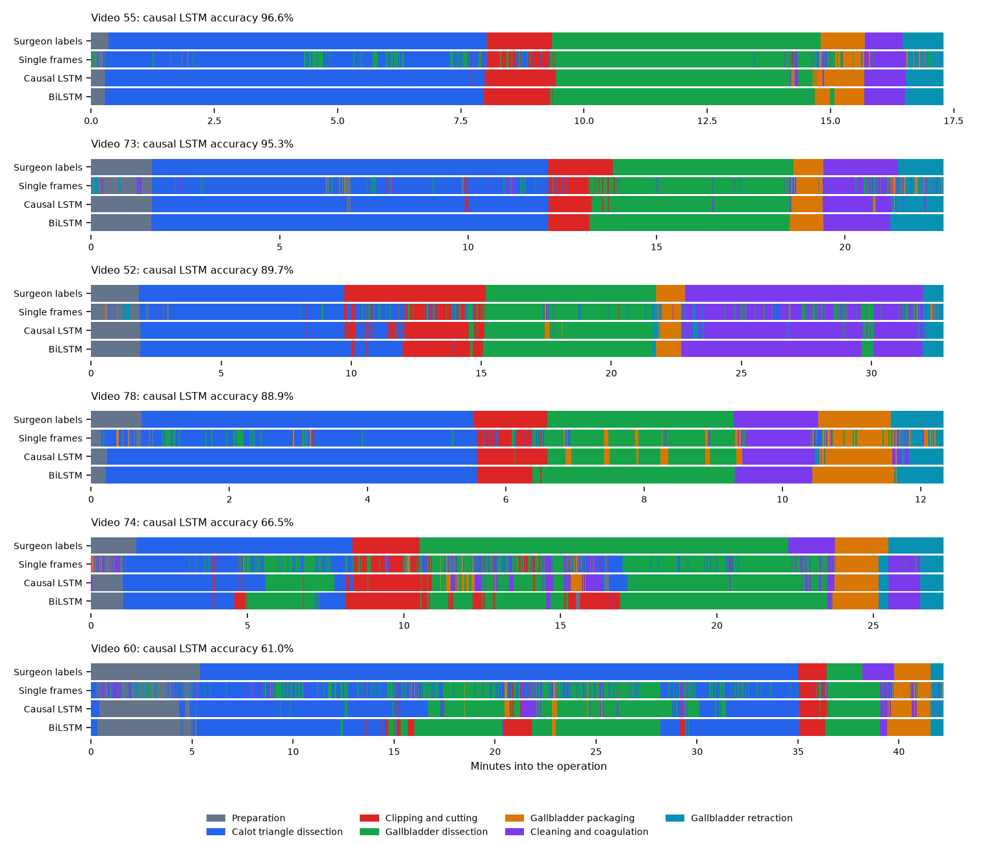
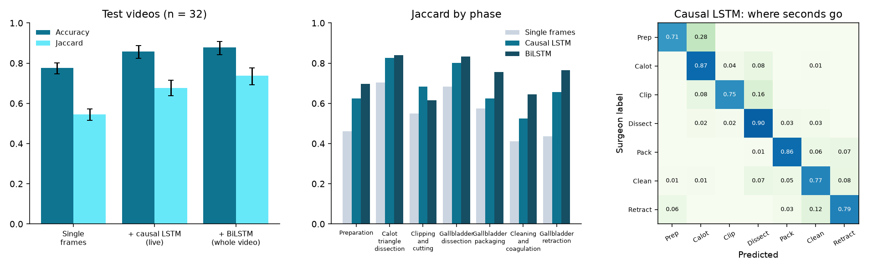

# SurgiPhase: recognising the phases of keyhole surgery from video

Labels each second of a laparoscopic gallbladder removal with one of seven surgical phases,
using a ResNet-50 frame encoder and an LSTM that follows the operation over time. Trained and
evaluated on the Cholec80 dataset.

> Research prototype for education. Not for clinical use. Dataset licence CC BY-NC-SA 4.0:
> non-commercial research only.



*Six test operations: the two best, two typical and the two worst. Top row of each block is
the surgeon annotation; below it, the three models.*

## Headline results

32 test operations the models never saw. Accuracy is per second, computed per operation and
averaged.

| System | Accuracy | 95% CI | Jaccard |
|---|---|---|---|
| ResNet-50 on single frames | 77.6% | 74.7 to 80.2 | 0.545 |
| **ResNet-50 + causal LSTM (usable live)** | **85.7%** | 82.4 to 88.7 | 0.678 |
| ResNet-50 + BiLSTM (sees the whole video) | 87.8% | 84.3 to 90.9 | 0.737 |

What the numbers say:

1. **Time context is worth 8 points.** A single frame is often ambiguous; knowing what came
   before fixes most of the flicker (p < 0.0001, paired over operations).
2. **Seeing the future adds 2 more**, but only an offline system can do that. The causal model
   is the one that could run during an operation.
3. **Performance varies a lot between operations**: from 61.0% to 96.6% for the causal model,
   with 2 of 32 below 70%. The average hides the hard cases.
4. **Short phases are hardest.** Cleaning and coagulation (8% of operating time) has Jaccard
   0.525, against 0.827 for Calot triangle dissection (39%).

Full tables: [reports/RESULTS.md](reports/RESULTS.md). Method and discussion:
[reports/REPORT.md](reports/REPORT.md).



## Read this before comparing with papers

Published Cholec80 results train on 40 operations and test on 40. This project used **66 of
the 80 videos** because of a 50 GB download limit: the 14 largest files were left out. The
split keeps the standard halves (videos 1 to 40 for training and validation, 41 to 80 for
testing), giving 29 training, 5 validation and 32 test operations. With 27% fewer training
operations and a size-based selection, these numbers are **not directly comparable** with the
literature.

## How it works

1. **Frames**: one per second, short side resized to 224 pixels (131,320 frames).
2. **Frame encoder**: ImageNet ResNet-50 fine-tuned for 5 epochs to classify the phase of a
   single frame (AdamW, cosine schedule, label smoothing, light augmentation, mixed precision).
3. **Features**: the 2048-value embedding of every frame is cached.
4. **Temporal model**: an LSTM (512 units) reads each operation's feature sequence. The causal
   version only looks backwards in time; a unit test checks that changing future frames cannot
   change past predictions.
5. **Evaluation**: accuracy, precision, recall and Jaccard per operation, bootstrap confidence
   intervals over operations, paired permutation tests.

## Quick start

```bash
python -m venv .venv
.venv\Scripts\activate            # Windows   (Linux/macOS: source .venv/bin/activate)
pip install -e ".[dev]"

python scripts/download_subset.py --budget-gb 46.5   # 66 videos, 46 GB, resumable
python -m surgphase.train                            # frames, training, evaluation (~25 min on an RTX 5060)
pytest                                               # 9 tests
streamlit run app/streamlit_app.py
```

The app shows the phase timeline of any test operation from the predictions stored in this
repository. Browsing the video frames needs the dataset downloaded locally.

`scripts/download_subset.py` reads the directory of the 75 GB archive remotely and pulls only
the chosen videos in resumable 16 MB chunks.

## Data and credits

Cholec80: Twinanda AP, Shehata S, Mutter D, Marescaux J, de Mathelin M, Padoy N. EndoNet: A
Deep Architecture for Recognition Tasks on Laparoscopic Videos. IEEE Trans Med Imaging, 2016.
CAMMA, University of Strasbourg. https://camma.unistra.fr/datasets/ . Licence CC BY-NC-SA 4.0.
No videos or frames are stored in this repository.

## Author

Hariharan S

## License

Code: MIT. Results derived from Cholec80 are for non-commercial research use, following the
dataset licence.
