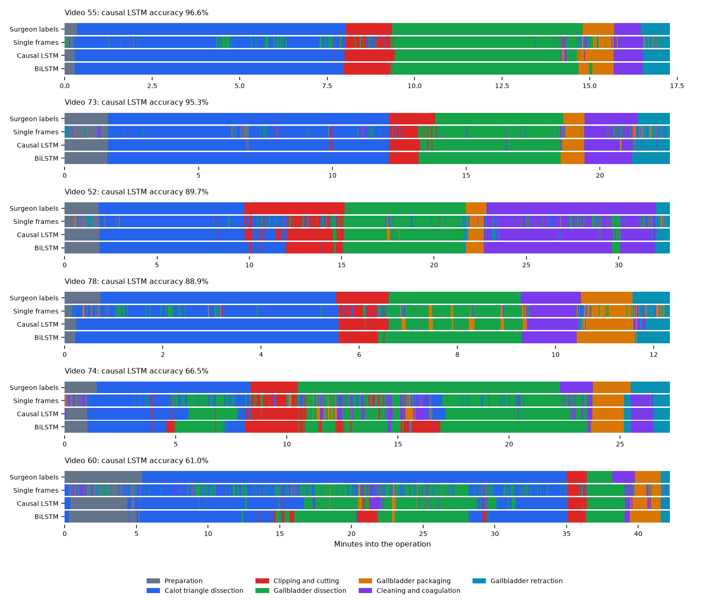

# Surgical phase recognition on a 66-video subset of Cholec80: frame, causal and offline models

**Hariharan S**

## Abstract

**Background.** Recognising the current phase of an operation from the endoscope video
underpins context-aware assistance, automatic documentation and surgical training.
**Objective.** To build a phase-recognition pipeline for laparoscopic cholecystectomy and
measure how much temporal modelling adds over single-frame classification, separating models
that can run live from those that need the whole recording. **Methods.** 66 of the 80 Cholec80
videos were used (a 50 GB download limit; the 14 largest files omitted): 29 for training, 5 for
validation and 32 for testing, respecting the standard train/test halves. A ResNet-50 was
fine-tuned on frames sampled at 1 fps; its embeddings fed a causal LSTM and a bidirectional
LSTM. Metrics were computed per video with bootstrap confidence intervals. **Results.**
Single-frame accuracy was 77.6% (95% CI 74.7 to 80.2). The causal LSTM reached 85.7% (82.4 to
88.7) and the bidirectional LSTM 87.8% (84.3 to 90.9); both steps were significant
(p < 0.0001). Jaccard rose from 0.545 to 0.678 and 0.737. Per-video accuracy of the causal
model ranged from 61.0% to 96.6%. **Conclusion.** Temporal context is the main driver of
performance, and a live-capable model recovers most of the gain. Wide variation between
operations is the main obstacle to dependable use.

## 1. Introduction

A cholecystectomy follows a recognisable sequence: preparation, dissection of Calot's
triangle, clipping and cutting of the cystic duct and artery, dissection of the gallbladder
from the liver, packaging, cleaning and coagulation, and retraction. A system that knows the
current phase can anticipate instruments, flag unusual durations and index recordings. The
visual evidence in one frame is often ambiguous (smoke, blood, the camera outside the
abdomen), so temporal models are standard. Two settings matter and are often conflated: online
recognition, where only the past is available, and offline analysis of a finished recording.

## 2. Methods

**Data.** Cholec80: 80 cholecystectomy videos at 25 fps from 13 surgeons with a phase label
per frame. Because of a 50 GB data limit, the 66 smallest video files were downloaded by
reading the archive directory remotely and fetching members by byte range. Videos 1 to 40
supplied training (29) and validation (5: videos 5, 13, 22, 30, 37); videos 41 to 80 supplied
the test set (32). Frames were sampled at 1 fps and resized to a height of 224 pixels:
131,320 frames, of which 53,850 were training frames.

**Frame encoder.** ImageNet-pretrained ResNet-50, all layers fine-tuned for 5 epochs with
AdamW (learning rate 3e-4, cosine decay with warm-up, weight decay 0.05), batch 64, label
smoothing 0.1, random resized crops, horizontal flips and colour jitter, mixed precision. The
epoch with the best validation accuracy was kept (80.3%).

**Temporal models.** The 2048-d pooled embedding of each frame was cached. A single-layer LSTM
(512 hidden units, preceded by dropout 0.5 and a linear projection) was trained on whole-video
sequences for 40 epochs with AdamW (5e-4) and small Gaussian feature noise; the epoch with the
best validation accuracy was kept. Two variants: unidirectional (causal; validation 90.5%) and
bidirectional (offline; validation 93.7%).

**Metrics.** Per video: accuracy, and per-phase precision, recall and Jaccard index, with
phases absent from both truth and prediction skipped. Results are means over videos; 95%
confidence intervals by bootstrap over videos (5,000 resamples); paired permutation tests on
per-video accuracy. No relaxed boundaries were applied.

## 3. Results

| System | Accuracy (SD) | Precision | Recall | Jaccard |
|---|---|---|---|---|
| Single frames | 0.776 (0.078) | 0.720 | 0.706 | 0.545 |
| Causal LSTM | 0.857 (0.091) | 0.807 | 0.823 | 0.678 |
| BiLSTM | 0.878 (0.094) | 0.857 | 0.854 | 0.737 |

Full tables: [RESULTS.md](RESULTS.md).

**By phase (causal LSTM).** The two long phases were recognised best: Calot triangle
dissection (Jaccard 0.827; 38.5% of test time) and gallbladder dissection (0.801; 32.9%).
Cleaning and coagulation was weakest (0.525; 8.3%), followed by preparation (0.624, with
recall 0.678) and gallbladder packaging (0.625).

**By operation.** Causal-LSTM accuracy had median 89.3%, minimum 61.0% and maximum 96.6%; two
of 32 operations fell below 70%. In the worst cases the model switched to gallbladder
dissection or clipping long before the surgeon label did, in operations with an unusually long
Calot dissection.

## 4. Discussion

**Temporal context.** The single-frame model flickers between phases; the LSTM removes most of
this and adds 8.1 points of accuracy and 0.133 Jaccard. The bidirectional model adds another
2.1 points by using what happens later, which is unavailable during surgery. Reporting both
makes clear which number applies to which use.

**Failure pattern.** Errors concentrate where the operation departs from the typical timeline.
A model that has learned "after about ten minutes of dissection comes clipping" is wrong when
dissection takes thirty. With only 29 training operations, unusual courses are barely
represented.

**Comparison with the literature.** Published methods on the full dataset with the 40/40
protocol report higher accuracy. The gap is expected and cannot be attributed to method alone:
this study trained on 29 operations instead of 40 (with 5 held out for validation), selected
videos by file size, tuned nothing beyond model selection, and used a plain LSTM. The results
should be read as a controlled comparison of three settings on identical data, not as a
benchmark entry.

**Limitations.** (1) Selection by file size may bias towards shorter or lower-resolution
recordings; the omitted videos include the largest and probably longest cases. (2) One
training run per model, so seed variance is unmeasured. (3) One hospital and one procedure.
(4) Phase labels have inherent ambiguity at transitions, and no boundary tolerance was used.
(5) No measurement of inference latency on operating-room hardware.

**Future work.** Train on the full dataset when bandwidth allows; temporal convolutional or
transformer models; tool-presence as an auxiliary task; uncertainty estimates so the system
can abstain on atypical operations.

## References

1. Twinanda AP, et al. EndoNet: a deep architecture for recognition tasks on laparoscopic
   videos. IEEE Trans Med Imaging. 2017;36(1):86-97.
2. He K, Zhang X, Ren S, Sun J. Deep residual learning for image recognition. CVPR 2016.
3. Hochreiter S, Schmidhuber J. Long short-term memory. Neural Comput. 1997;9(8):1735-1780.
4. Jin Y, et al. SV-RCNet: workflow recognition from surgical videos using recurrent
   convolutional network. IEEE Trans Med Imaging. 2018;37(5):1114-1126.
5. Maier-Hein L, et al. Surgical data science for next-generation interventions. Nat Biomed
   Eng. 2017;1:691-696.
